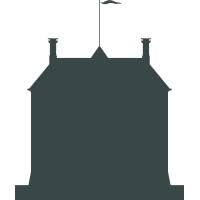

# Erfgoedzoeker

> [!WARNING]  
> This project is under active development, things may change or break as we work toward releasing v1.0.

Erfgoedzoeker is a **reusable, flexible heritage data browser**: an off-the-shelf solution for searching and browsing heritage data. You can use it to configure exactly what, how, and when your data is shown to users through an intuitive web interface, no technical knowledge required.

| Search interface                                                                                          | Configurator                                                                                              |
| --------------------------------------------------------------------------------------------------------- | --------------------------------------------------------------------------------------------------------- |
|  |  |

Erfgoedzoeker is built to conform to two [NDE behavior profiles](https://zenodo.org/records/14938780):

1. Targeted search
2. Browsing and discovery

Connect it to an [NDE-compatible data layer](https://docs.erfgoedzoeker.nl/guide/getting-started.html#data-layer-dependency) (GraphQL or REST) to go from a raw linked data dump (.ttl, .trig, .jsonld, ...) to a fully featured search interface in a couple of minutes.

## Prerequisites

> [!IMPORTANT]
> Erfgoedzoeker requires a **data layer** endpoint to function. NDE's specification is still in development, so both GraphQL and REST are supported. See [Getting Started](https://docs.erfgoedzoeker.nl/guide/getting-started.html) for available implementations.

- [Node.js](https://nodejs.org/) v20.19.0 (or newer) and [pnpm](https://pnpm.io/)
- A data layer endpoint (see above)

## Installation

Clone the repository and install dependencies:

```bash
git clone https://github.com/Simon-Dirks/erfgoedzoeker.git
cd erfgoedzoeker
npm install
```

## Configuration

Erfgoedzoeker is configured through `apps/erfgoedzoeker/public/config/erfgoedzoeker.config.json`. To get started, set the data layer protocol and URL:

```json
{
  "$schema": "./erfgoedzoeker.config.schema.json",
  "api": {
    "type": "graphql",
    "baseUrl": "http://localhost:4000/graphql"
  }
}
```

Alternatively, use the Configurator app (`pnpm run configurator:dev`) to edit all Erfgoedzoeker settings through an intuitive UI. See [docs.erfgoedzoeker.nl](https://docs.erfgoedzoeker.nl) for the full configuration reference.

## Running the Application

Start the development server:

```bash
npm start
```

Navigate to `http://localhost:4200/` to see the application in action.

## Documentation

You can find more information on how to use and configure Erfgoedzoeker at [docs.erfgoedzoeker.nl](https://docs.erfgoedzoeker.nl).

## Acknowledgements

Erfgoedzoeker is developed with the generous support of:

<table>
  <tr>
    <td align="center" width="200">
      <a href="https://netwerkdigitaalerfgoed.nl/">
        <br />
      </a>
      <span>Netwerk Digitaal Erfgoed</span>
    </td>
    <td align="center" width="200">
      <a href="https://nadd.network">
        <br />
      </a>
      <span>NADD</span>
    </td>
    <td align="center" width="200">
      <a href="https://www.razu.nl/">
        <br />
      </a>
      <span>Regionaal Archief Zuid-Utrecht</span>
    </td>
    <td align="center" width="200">
      <a href="https://www.hetutrechtsarchief.nl/">
        <br />
      </a>
        <span>Het Utrechts Archief</span>
    </td>
    <td align="center" width="200">
      <a href="https://www.kasteelamerongen.nl/">
        <br />
      </a>
      <span>Kasteel Amerongen</span>
    </td>
  </tr>
</table>

## License

See [LICENSE.md](LICENSE.md)
